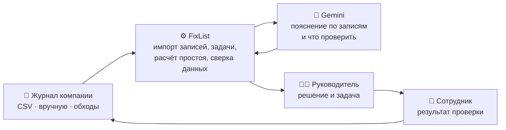

<div align="center">

# FixList

### ИИ-помощник службы эксплуатации: от сигнала оборудования — до результата проверки

**ИИ находит повторяющиеся сбои, подсказывает, что проверить, и помогает довести проблему до решения.<br>Каждый ответ ИИ опирается на реальные записи журнала — их видно прямо под ответом.**

[](LICENSE)


[ИИ в FixList](#-ии--ядро-fixlist) · [Как это работает](#-как-это-работает) · [Быстрый старт](#-быстрый-старт) · [Архитектура](docs/architecture.md) · [План развития](docs/roadmap.md)

<br>


</div>

<br>

> **Рабочий MVP на открытом архиве Kelmarsh.** В FixList загружены реальные записи SCADA ветропарка:
> **177 событий остановки · 6 турбин · сигнал 4588 на Kelmarsh 3 повторился 9 раз.**

<br>

## ⚠️ Проблема

**Остановки срывают работу производства.**
Когда сигнал повторяется, службе эксплуатации нужно быстро найти прошлые случаи, назначить ответственного и узнать результат проверки. Сегодня записи разбросаны по тетрадям, чатам и таблицам, а повторный сбой легко принять за новый.

<br>

## 🤖 ИИ — ядро FixList

FixList связывает проблему, оборудование, задачи и результаты проверок в одном кабинете — и **ИИ помогает решить проблему на каждом шаге**.

<table>
<tr>
<td width="50%" valign="top">

### 🔎 Увидеть проблему
FixList разбирает журнал и показывает, **какие сигналы повторяются**, на каком оборудовании и как часто. Повторный сбой больше не теряется среди новых записей.

</td>
<td width="50%" valign="top">

### 🧠 Понять, что проверить
В карточке события **ИИ подсказывает, что проверить** и как убедиться в результате. Кнопка **«Решить с ИИ»** превращает подсказку в план действий.

</td>
</tr>
<tr>
<td width="50%" valign="top">

### 💬 Спросить по журналу
**Ассистент на Gemini** отвечает на вопросы о событиях: «Что происходило на Kelmarsh 3 в апреле?». Под ответом видны **исходные записи** — оборудование, дата, код.

</td>
<td width="50%" valign="top">

### ✅ Довести до результата
ИИ помогает руководителю назначить проверку, а сотруднику — записать, что проверено. **Итог остаётся в истории оборудования.**

</td>
</tr>
</table>

### Почему ИИ в FixList можно доверять

- **Код считает — ИИ объясняет.** Простои, повторы, интервалы и деньги рассчитываются по журналу, а Gemini формулирует пояснение.
- **Код сверяет ответ.** Числа и названия оборудования в тексте ИИ проверяются по базе перед показом.
- **Источники всегда на виду.** Под каждым ответом — записи из журнала, по которым его можно проверить.
- **ИИ не выдумывает факты.** Если причины нет в данных, FixList не выдаёт догадку за факт.
- **Ключ Gemini хранится на сервере**, а при сбое сети или лимите сервис продолжает работать по данным журнала.

<br>

## 🔁 Как это работает

| Шаг | Кто | Что происходит |
| :---: | --- | --- |
| **01 · Создать** | Руководитель | Открывает запись журнала, ИИ подсказывает, что проверить, — и создаётся задача на проверку |
| **02 · Назначить** | Руководитель | Выбирает решение и ответственного, отслеживает статус задачи |
| **03 · Закрыть** | Сотрудник | Записывает результат проверки — он остаётся в истории оборудования |

**Карточка задачи** связывает событие, решение, исполнителя и итог проверки.

<br>

## 🧩 Возможности

**Свой журнал, свой кабинет.** Любая компания может загрузить оборудование и события из CSV или внести их вручную. Сразу после загрузки записи доступны в карточках, истории и **ИИ-ассистенте**.

**Кто отвечает за проверку.** Руководитель добавляет сотрудников и поручает проверку прямо из карточки. Сотрудник видит свои задачи, отмечает замечания на обходе и сохраняет результат проверки.

**Руководитель видит новые карточки.** Руководитель указывает email в аккаунте FixList. Новая заявка или замечание с обхода запускает уведомление: в письме указано, что произошло, где и когда. ([Настройка Gmail](docs/email-notifications.md))

**Простой в часах и деньгах.** FixList показывает, какие остановки обходятся дороже всего. Руководитель сравнивает потенциальную экономию и окупаемость мер.

**Доступ и безопасность.** У каждой компании отдельный кабинет. Роли ограничивают доступ. PIN хранится в виде хеша, ключ Gemini — на сервере.

<br>

## 🏗 Что стоит за карточкой



| Слой | Технологии |
| --- | --- |
| ИИ | Gemini API (Flash-Lite): пояснения, подсказки «что проверить», ассистент по журналу |
| Приложение | Python, Streamlit |
| Данные | SQLite, отдельный кабинет для каждой компании |
| Безопасность | роли, PIN в виде хеша, ключи только на сервере (`.env`) |

<br>

## 💼 Бизнес-модель

### Подписка за площадку — дешевле часа простоя

Начинаем с небольших производств, где своя команда отвечает за эксплуатацию оборудования.

> **Подписка — 30 000 ₸ в месяц за площадку.**
> При примерном тарифе простоя 50 000 ₸/ч это **около 36 минут простоя**.
> Для сравнения: одна остановка Kelmarsh 3 по сигналу 4588 длилась 1 ч 27 мин — **≈ 72 847 ₸** по тому же тарифу.
> **FixList окупается, если помог сократить простой хотя бы на 36 минут в месяц.**

| Расчётная гипотеза · на площадку в месяц | |
| --- | ---: |
| Подписка | **30 000 ₸** |
| Инфраструктура, ИИ и поддержка | 10 000 ₸ |
| Вклад в покрытие остальных расходов | 20 000 ₸ |

### Тарифы растут вместе с клиентом

| Тариф | Для кого | Что входит | Цена |
| --- | --- | --- | --- |
| **Старт** | один цех | журнал событий, задачи на проверку, ИИ-подсказки, ассистент по журналу | 30 000 ₸ / мес |
| **Площадка** | производство с несколькими участками | всё из «Старта» + уведомления, отчёты по простою и деньгам, расширенный лимит ИИ | определим в пилоте |
| **Интеграция** | крупные клиенты | всё из «Площадки» + загрузка данных из SCADA или учётной системы, внедрение | разовое внедрение + подписка |

### Каналы продаж

1. **Напрямую — руководителям служб эксплуатации** небольших производств и цехов.
2. **Через сервисные компании**, которые обслуживают оборудование у нескольких заказчиков: одна такая компания приносит сразу несколько площадок, а FixList показывает её заказчикам, что проверено и чем закончилось.

### Пилот → подписка

| Этап | Что делаем | Что измеряем |
| --- | --- | --- |
| **Пилот, 2 недели** | загружаем журнал цеха, подключаем сотрудников | время от появления карточки до назначения исполнителя, доля задач с записанным результатом |
| **Подписка «Старт»** | переводим цех на подписку | сокращение простоя и времени на поиск истории |
| **Расширение** | другие участки и площадки клиента, тарифы «Площадка» и «Интеграция» | число площадок у одного клиента |

> Цены тарифов «Площадка» и «Интеграция», а также расходы проверяем в пилоте. Тариф простоя 50 000 ₸/ч — пример для расчёта, у каждого клиента он свой.

<br>

## 🚀 Быстрый старт

Нужны **Python 3.11+**, **Git** и ключ **Gemini API** — он создаётся за минуту в [Google AI Studio](https://aistudio.google.com/apikey). Запуск занимает пару минут.

**macOS / Linux**

```sh
git clone https://github.com/ERA216/FixList.git
cd FixList
python3 -m pip install -r requirements.txt
cp .env.example .env        # впишите в .env ключ: GEMINI_API_KEY=ваш_ключ
python3 -m streamlit run app.py
```

**Windows (PowerShell или командная строка)**

```powershell
git clone https://github.com/ERA216/FixList.git
cd FixList
python -m pip install -r requirements.txt
copy .env.example .env      # впишите в .env ключ: GEMINI_API_KEY=ваш_ключ
python -m streamlit run app.py
```

Если команда `python` не найдена, используйте `py` вместо `python`.

После запуска откройте адрес из терминала — обычно **http://localhost:8501**. При первом запуске Streamlit может спросить email в терминале: просто нажмите **Enter**. База с реальными событиями Kelmarsh создаётся автоматически.

**Вход в демо-кабинет**

| Роль | Код компании | Логин | PIN |
| --- | --- | --- | --- |
| Руководитель | `FIXLIST` | `boss` | `1111` |
| Сотрудник | `FIXLIST` | `master` | `2222` |

Вернуть демо-данные в исходное состояние: остановите приложение (`Ctrl+C`) и выполните `python scripts/reset_db.py`.

<details>
<summary><b>Подключение Gemini</b></summary>

<br>

```dotenv
LLM_PROVIDER=gemini
GEMINI_API_KEY=ваш_ключ
LLM_MODEL=gemini-3.5-flash-lite
```

Ключ храните только в `.env` или в закрытых переменных окружения хостинга (например, Secrets в Streamlit Community Cloud) — не добавляйте его в GitHub. Проверка подключения: `python scripts/check_gemini.py` — команда отправляет один короткий запрос и сообщает, работает ли ключ. [Как получить ключ Gemini](https://ai.google.dev/gemini-api/docs/api-key).

</details>

<br>

## 📚 Данные

Демо работает на открытом архиве [Kelmarsh wind farm SCADA](https://zenodo.org/records/16807551) (CC BY 4.0): реальные записи остановок шести турбин. Подробнее: [docs/open-data.md](docs/open-data.md).

<br>

## 🗺 Следующий шаг — пилот в одном цехе

Загрузим журнал цеха, подключим сотрудников и замерим время от появления карточки до назначения исполнителя.

Подробнее: [docs/roadmap.md](docs/roadmap.md)

<br>

## 👥 Команда Leader Labs

Павлодар, Казахстан · [@ERA216](https://github.com/ERA216) · [@ersinabylai-ctrl](https://github.com/ersinabylai-ctrl)

| 🏆 | |
| --- | --- |
| **Победа на хакатоне Superteam KZ** | 100 000 ₸ — приз команды |
| **Номинация на AI хакатоне** | «Лучшее инновационное решение в области промышленных технологий» |
| **Venture Startup Battle 2026** | участник |

<br>

## 📄 Лицензия

MIT — см. [LICENSE](LICENSE). Данные Kelmarsh распространяются по лицензии CC BY 4.0.

<div align="center">
<br>
<b>FixList</b> — ИИ, который помогает не потерять повторный сигнал и довести проверку до результата.
</div>
