<div align="center">

# FixList

### От сигнала оборудования — до результата проверки

**Веб-сервис для команд эксплуатации: фиксирует остановки, находит повторяющиеся сигналы,<br>превращает событие в задачу на проверку и сохраняет её итог в истории оборудования.**

[](LICENSE)


[Как это работает](#-как-это-работает) · [Кейс 4588](#-кейс-один-сигнал-девять-повторов) · [Быстрый старт](#-быстрый-старт) · [Архитектура](docs/architecture.md) · [План развития](docs/roadmap.md)

<br>

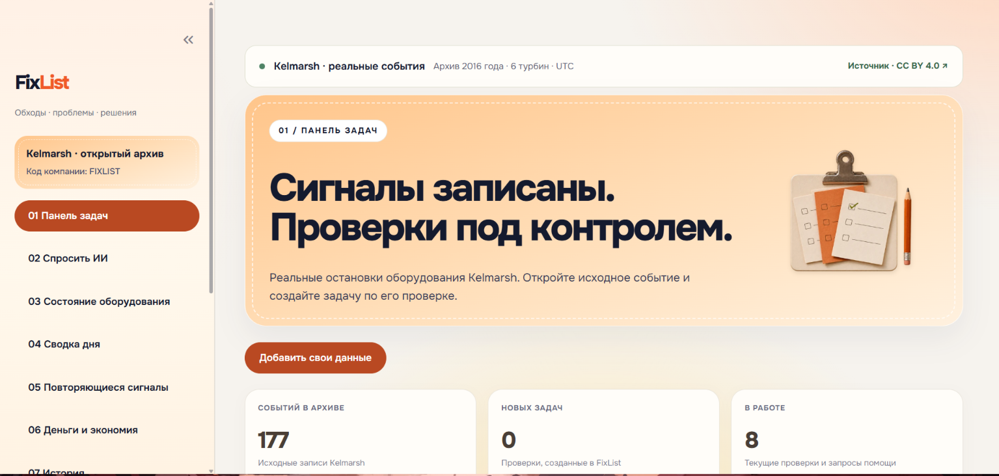

</div>

<br>

> **177 реальных остановок · 6 ветротурбин · 2016 год.**
> FixList работает не на выдуманных примерах, а на открытом архиве SCADA ветропарка Kelmarsh.
> Каждое число в интерфейсе можно проследить до исходной записи журнала.

<br>

## ⚡ Зачем это нужно

Сотрудник записал замечание. Следующая смена видит похожий сбой — и принимает его за новый.
Чтобы связать события, мастеру приходится вручную искать записи в журналах и переписках.

| Без FixList | С FixList |
| --- | --- |
| Записи разбросаны по тетрадям, чатам и таблицам | Все события оборудования — в одном журнале компании |
| Повторный сигнал выглядит как новый | Повторы и интервалы между ними видны сразу |
| Неясно, кто проверяет и чем всё закончилось | Задача с исполнителем, статусом и сохранённым результатом |
| Потери от простоя никто не считает | Стоимость простоя и сценарий экономии по вашему тарифу |

**Для кого:** мастера смен и руководители служб эксплуатации в цехах, на производственных площадках и в сервисных командах.

<br>

## 🔁 Как это работает

Один сквозной сценарий — от записи о проблеме до результата проверки.

<table>
<tr>
<td width="50%" valign="top">

**1 · Найти сигнал**<br>
Поиск по оборудованию, коду или тексту записи. Код `4588` — и на экране все его остановки с длительностью и оценкой потерь.

</td>
<td width="50%" valign="top">

**2 · Открыть карточку события**<br>
Время начала и окончания, длительность, исходный код, денежный эффект и ссылка на первоисточник.

</td>
</tr>
<tr>
<td>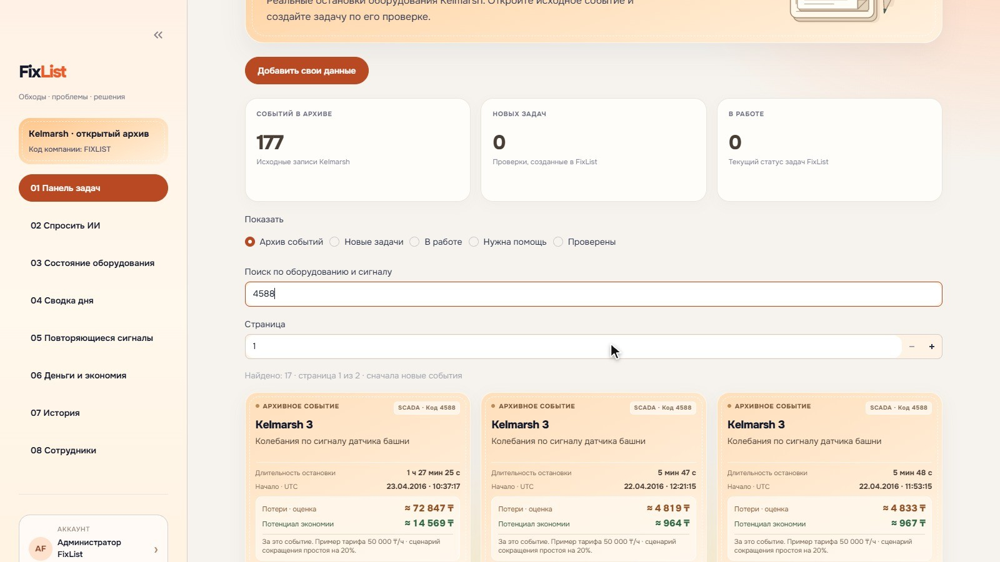</td>
<td>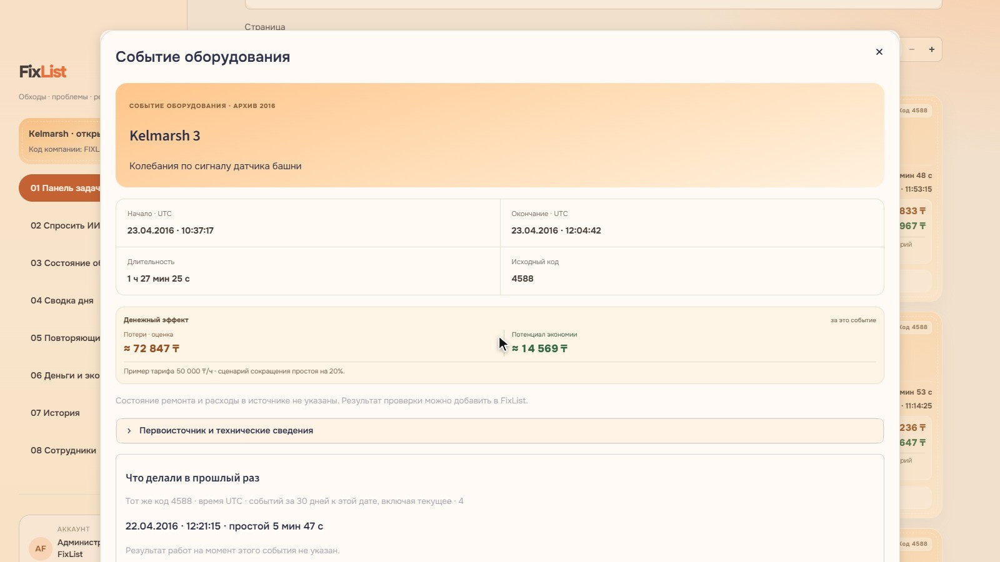</td>
</tr>
<tr>
<td width="50%" valign="top">

**3 · Получить подсказку и создать задачу**<br>
Карточка подсказывает, что проверить, и показывает, сколько раз код уже встречался на этом объекте. Одна кнопка — и событие становится задачей.

</td>
<td width="50%" valign="top">

**4 · Назначить исполнителя**<br>
В задаче видна история похожих событий («Что делали в прошлый раз»). Руководитель выбирает сотрудника и поручает проверку.

</td>
</tr>
<tr>
<td>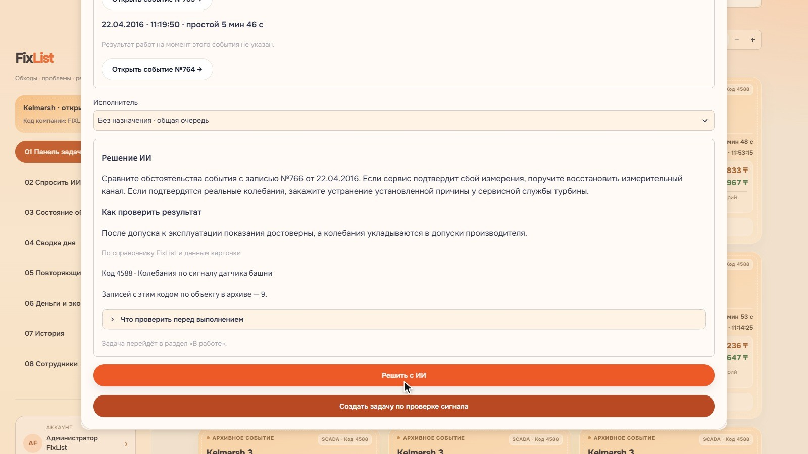</td>
<td>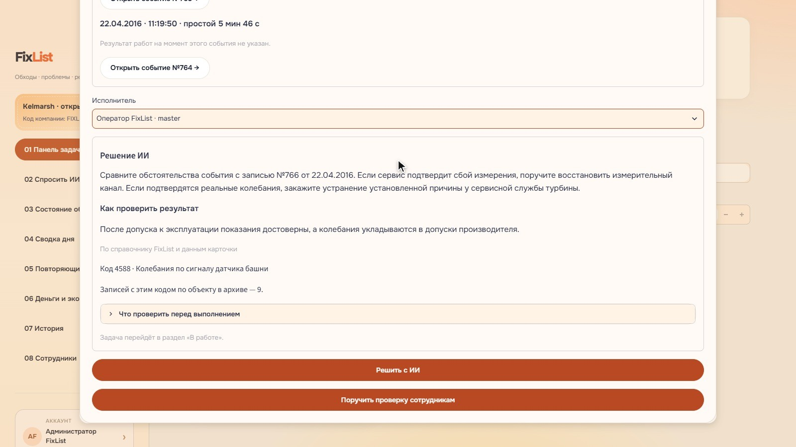</td>
</tr>
<tr>
<td width="50%" valign="top">

**5 · Сотрудник фиксирует результат**<br>
У сотрудника свой кабинет: «Мои задачи», причина и что сделано. Если нужна помощь — задача уходит обратно руководителю.

</td>
<td width="50%" valign="top">

**6 · Итог остаётся в истории**<br>
Задача переходит в «Проверены», а результат проверки сохраняется в карточке рядом с историей оборудования.

</td>
</tr>
<tr>
<td>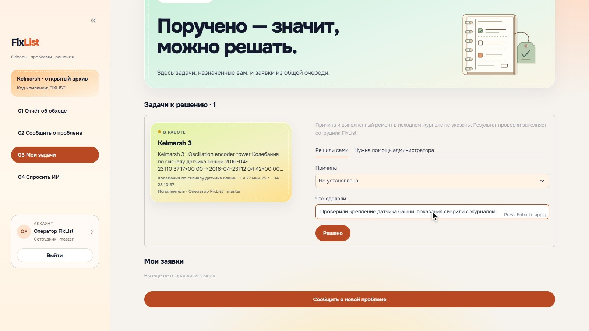</td>
<td>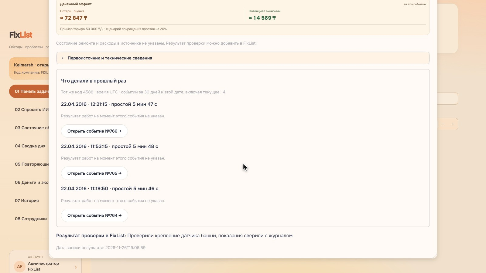</td>
</tr>
</table>

Статусы задачи: **Ждёт одобрения → В работе → (Нужна помощь администратора) → Проверены.**

<br>

## 📈 Кейс: один сигнал, девять повторов

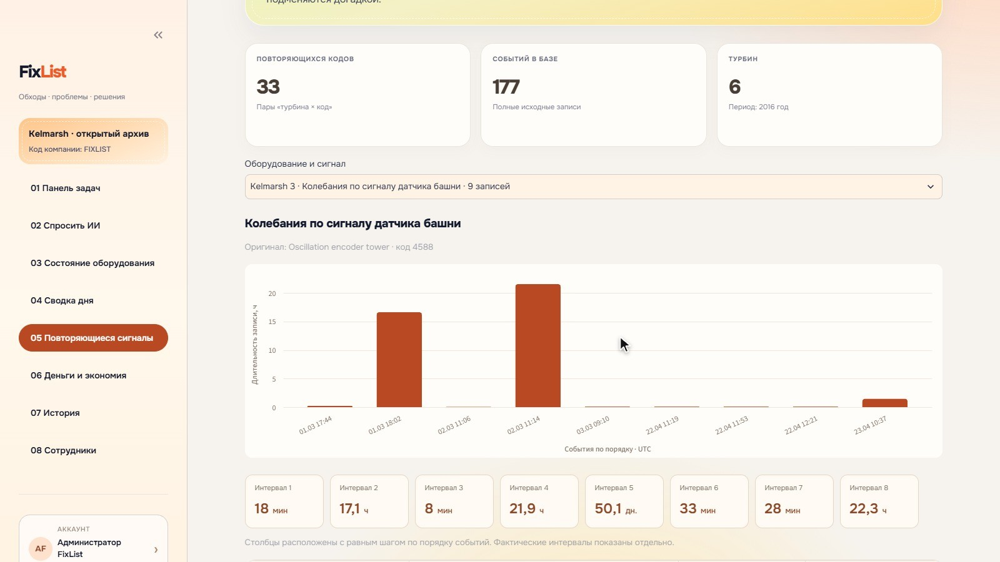

На турбине **Kelmarsh 3** сигнал **4588 «Колебания по сигналу датчика башни»** записан в журнале **9 раз** —
пять раз 1–3 марта и четыре раза 22–23 апреля 2016 года.

В обычном журнале это девять разрозненных строк. В FixList — одна история: график по датам, фактические интервалы между повторами (от 8 минут до 50 дней) и общая таблица повторяющихся пар «турбина × код» — всего их в архиве **33**.

> Девять повторов — это записи сигнала. Причина отказа в источнике не указана, и FixList не выдаёт догадку за факт: что именно проверить и чем закончилось, фиксирует команда.

<br>

## 🤖 ИИ, ответам которого можно верить

<table>
<tr>
<td width="55%">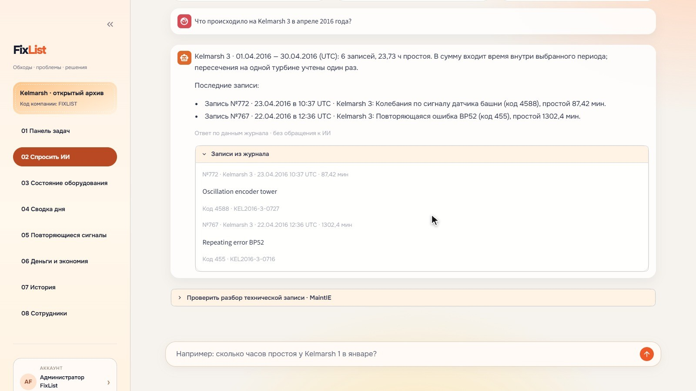</td>
<td width="45%" valign="top">

**Код считает — ИИ объясняет — код проверяет.**

- Отбор записей, часы простоя, интервалы и деньги считает **код**, а не модель.
- **Gemini** формулирует пояснение и предлагает, что проверить.
- Числа, названия оборудования, цитаты и ID записей в ответе **сверяются с базой** перед показом.
- Под каждым ответом — блок **«Записи из журнала»**: оборудование, дата, код, ID записи.
- Нет сети, ключа или лимита — сервис отвечает по данным журнала и **не падает**.

</td>
</tr>
</table>

<br>

## 💰 Простой в часах и деньгах

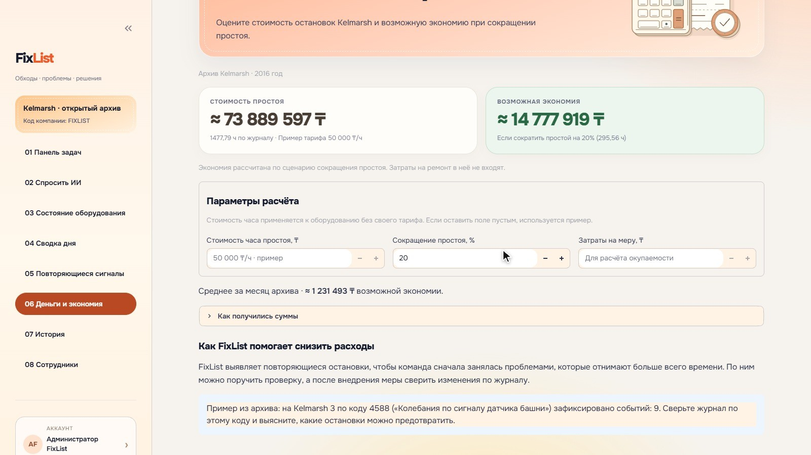

FixList показывает, какие остановки обходятся дороже всего. Тариф часа простоя и процент сокращения задаёт сам руководитель — например, при тарифе **50 000 ₸/ч** весь архив Kelmarsh (1 477,8 ч остановок) — это **≈ 73,9 млн ₸**, а сокращение простоя на 20 % — **≈ 14,8 млн ₸** потенциальной экономии.

> Это расчётный сценарий: тариф и доля сокращения — параметры, которые вводит пользователь, а не подтверждённая экономия.

<br>

## 🧩 Возможности

<table>
<tr>
<th width="50%">👷 Сотрудник</th>
<th width="50%">🧑‍💼 Руководитель / администратор</th>
</tr>
<tr>
<td valign="top">

- **Отчёт об обходе**: «норма / замечание / проблема» по каждому аппарату
- **Сообщить о проблеме** своими словами — на русском или казахском
- **Мои задачи**: поручённые проверки и общая очередь
- **Результат проверки** или запрос помощи администратора
- **Спросить ИИ** по данным своей компании

</td>
<td valign="top">

- **Панель задач**: архив событий, новые, в работе, нужна помощь, проверены
- **Карточка события** с историей похожих случаев и подсказкой, что проверить
- **Состояние оборудования** и **повторяющиеся сигналы** с интервалами
- **Сводка дня**, **деньги и экономия**, **история**
- **Сотрудники**: добавление списком, роли, PIN-доступ
- **Уведомления на email** о новых заявках и замечаниях ([настройка Gmail](docs/email-notifications.md))

</td>
</tr>
</table>

**Свои данные за минуту.** Кнопка «Добавить свои данные» — ввод оборудования вручную или загрузка справочника и журнала из CSV. Записи сразу появляются в карточках, истории и ассистенте. У каждой компании — отдельный кабинет.

<br>

## 🏗 Архитектура

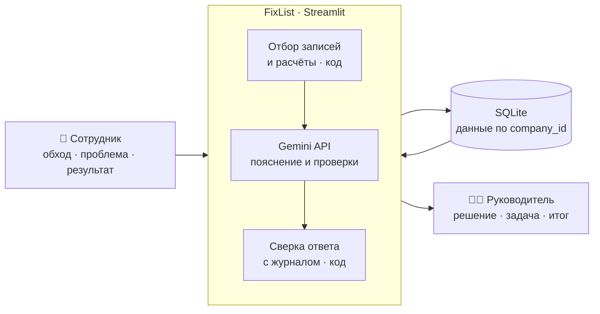

| Слой | Технологии |
| --- | --- |
| Интерфейс | Streamlit, собственный CSS (шрифт Onest, пастельные карточки, иллюстрации) |
| ИИ | Gemini Flash-Lite через REST; поддержка OpenAI и Anthropic; JSON-вывод, проверка схемой Pydantic, повторы и смена модели/ключа |
| Логика и аналитика | Python, pandas — часы, интервалы, деньги и прогноз считает только код |
| Данные | SQLite; справочники оборудования, причин и мер — JSON |
| Безопасность | ключи в `.env`, PIN в виде хеша PBKDF2-SHA256, сеанс на сервере, данные разделены по `company_id`, роли ограничивают доступ |
| Тесты | автотесты без сети и ключа: бэкенд, импорт данных, архив Kelmarsh, задачи, уведомления, интеграция Gemini |

Подробнее: [docs/architecture.md](docs/architecture.md)

<br>

## 🚀 Быстрый старт

Нужен Python 3.11+.

```sh
git clone https://github.com/ERA216/FixList.git && cd FixList
python -m pip install -r requirements.txt
cp .env.example .env            # Windows: copy .env.example .env — и впишите GEMINI_API_KEY
python -m streamlit run app.py
```

Откроется `http://localhost:8501`. При первом запуске создаётся база с реальными событиями Kelmarsh. Без ключа доступны история, расчёты и ответы по журналу.

| Роль | Код компании | Логин | PIN |
| --- | --- | --- | --- |
| Администратор | `FIXLIST` | `boss` | `1111` |
| Сотрудник | `FIXLIST` | `master` | `2222` |

Это тестовые пользователи FixList, а не сведения о сотрудниках ветропарка. Пересоздать демо-данные перед показом: `python scripts/reset_db.py`.

<details>
<summary><b>Подключение Gemini</b></summary>

<br>

Скопируйте `.env.example` в `.env` и заполните ключ. На сервере задайте значения в закрытых переменных окружения или Secrets хостинга:

```dotenv
LLM_PROVIDER=gemini
GEMINI_API_KEY=ваш_ключ
LLM_MODEL=gemini-3.5-flash-lite
```

Поддерживается и `GOOGLE_API_KEY` (`GEMINI_API_KEY` в приоритете). Ключи не добавляйте в GitHub и не передавайте в URL или код браузера. [Управление ключами Gemini](https://ai.google.dev/gemini-api/docs/api-key) · [модель Gemini 3.5 Flash-Lite](https://ai.google.dev/gemini-api/docs/models/gemini-3.5-flash-lite).

Проверка живого подключения (один короткий запрос на временной базе, без показа ключа):

```sh
python scripts/check_gemini.py
```

С подключённой моделью работают разбор текста, диагностика, сводка, подбор мер, чат и рекомендации карточек. Отметка ИИ появляется только после принятого и проверенного ответа модели; при ошибке сохраняется резервный режим с пояснением.

</details>

<details>
<summary><b>Тесты</b></summary>

<br>

```sh
python -m pytest -q                    # все проверки, без сети и ключа
python tests/test_primary_archive.py   # перенос и основные экраны на реальных данных
```

</details>

<br>

## 📚 Открытые данные

| Набор | Что внутри | Лицензия |
| --- | --- | --- |
| [Kelmarsh wind farm SCADA](https://zenodo.org/records/16807551) | 177 событий остановок шести турбин Senvion MM92 за 2016 год | CC BY 4.0 |
| MaintIE | 80 размеченных технических текстов для разбора записей | MIT |

Выборки включены в проект и работают без скачивания. Оригинальные даты сохранены; неизвестные расходы и результаты ремонтов остаются без значения. Происхождение и маршрут демо: [docs/open-data.md](docs/open-data.md).

<br>

## 🗺 Дальше

- [x] Журнал событий, карточки и задачи на проверку
- [x] Повторяющиеся сигналы, история и интервалы на реальных данных
- [x] Ассистент по журналу с проверкой ответов
- [x] Кабинеты компаний, роли, импорт CSV, уведомления
- [ ] **Пилот в одном цехе**: время от появления карточки до назначения исполнителя
- [ ] Telegram-бот для сотрудников
- [ ] Голосовые отчёты об обходе и фото поломки

Подробно: [docs/roadmap.md](docs/roadmap.md)

<br>

## 👥 Команда

**Leader Labs** · Павлодар, Казахстан — [@ERA216](https://github.com/ERA216) и [@ersinabylai-ctrl](https://github.com/ersinabylai-ctrl).

Проект создан на хакатоне «ИИ-приложение» (Торайгыров университет, 6 ноября 2026) и развивается для Venture Startup Battle 2026.

<details>
<summary><b>Соответствие ТЗ хакатона</b></summary>

<br>

| Требование | Как выполнено |
| --- | --- |
| Веб-интерфейс, один законченный сценарий | событие → карточка → задача → исполнитель → результат |
| Понятный интерфейс, состояние загрузки | подсказки, примеры, индикаторы работы ИИ |
| Хранение данных | SQLite: обходы, заявки, рекомендации, журнал вызовов ИИ |
| Обработка ошибок | пустой ввод, лимит и перегрузка ИИ, нет сети — понятное сообщение, сервис не падает |
| Ключи в `.env` | в коде и репозитории ключей нет (`.env` в `.gitignore`) |
| Персональные данные | не требуются; тестовые данные отмечены в базе (`is_demo`) |
| Запуск ≤ 5 команд | 4 команды выше |
| ИИ — ядро решения | своя логика, база знаний, проверка ответов, пометка ИИ |

</details>

<br>

## 📄 Лицензия

MIT — см. [LICENSE](LICENSE). Внешние данные сохраняют лицензии первоисточников: Kelmarsh — CC BY 4.0, MaintIE — MIT. Авторы и изменения указаны в [описании данных](docs/open-data.md) и в разделе приложения «История».

<div align="center">
<br>
<b>FixList</b> — чтобы повторный сигнал не принимали за новый.
</div>
